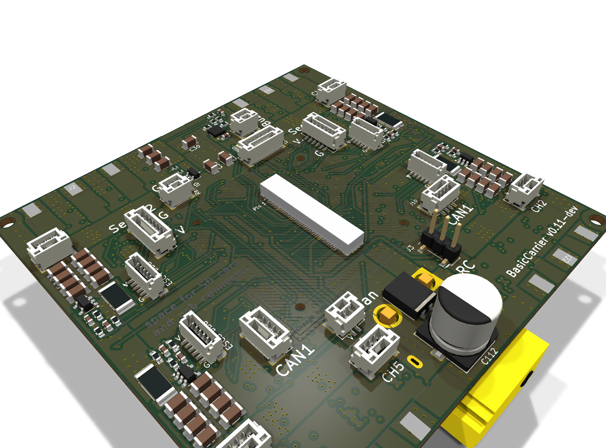

# JapanDrones BasicCarrier



Carrier board for a CubePilot Cube (CubeOrange / CubeOrange+, DF17 80-pin connector) used on the JapanDrones aerial photography copter.
It carries the Cube and four ESCs (one per corner), so a quadcopter needs no separate ESCs or power board.

- 91.14 × 90 mm, 6 layers, 1.6 mm, parts on both sides (MOSFETs, drivers and regulators on the bottom for cooling)
- Battery in through an XT90 (bottom side, overhanging the rear edge), up to 6S
- Four AM32 ESCs on the board: STM32L431 + FD6288 gate driver + 6 × TPHR8504PL MOSFETs each, 1 mΩ shunt with INA180 current sense, DroneCAN on the Cube's CAN2 bus
- 10 V and 5.2 V buck converters, USB/battery power changeover (TPS2121) with VBUS and brick-valid flags to the Cube
- JST-GH connectors: CAN1, two serial ports, five FMU PWM outputs for LEDs, RC input, buzzer and fan (fan on battery voltage)

Designed by Swapnil Marathe for JapanDrones.

## Status

**v0.11: pre-fab.** The layout was reviewed twice (`review/`); fab outputs for PCBWay are in `fab/v0.11/`, with `ORDER-NOTES.md` and `BRINGUP.md`.
v0.10 was built by PCBWay in September 2026. Its known problems (battery connector gender, CAN_H/CAN_L swap, fan on 5 V, quiet buzzer) are fixed in v0.11.
Open items carried into v0.11 are listed at the end of `fab/v0.11/BRINGUP.md`.

## Folder map

| Path | What |
|---|---|
| `JapanDrones_BasicCarrier.kicad_pro/.kicad_sch/.kicad_pcb` | KiCad 10 project, top-level schematic and PCB |
| `Connectors.kicad_sch`, `PowerSheet.kicad_sch`, `USBSheet.kicad_sch` | Schematic sub-sheets |
| `VimDrones_mod.kicad_sch` | One ESC (used four times), derived from the VimDrones AM32 ESC development board |
| `JapanDrones_BasicCarrier.kicad_dru` | Custom DRC rules (battery copper away from the edge and the corner screws) |
| `JapanDrones.kicad_sym`, `JapanDrones.pretty/` | Project symbol and footprint libraries |
| `3dmodels/` | Generated placeholder 3D models for parts without a KiCad stock model |
| `fab/<rev>/` | What was (or will be) sent to the fab for that revision: Gerbers + drill zip, BOM, positions, IPC netlist, schematic PDF, notes |
| `fab/v0.11-wip/` | STEP of the assembled board for mechanical CAD |
| `tools/` | `make_fab.py` (fab outputs), `make_pcbway_fab.py` (BOM and positions), `check_netlist.py` (Cube DF17 pin-mapping check; pass `--pinmap` with the CubeOrange pin-mapping spreadsheet, which is not in this repo), STEP and 3D-model helpers |
| `review/` | Design reviews of v0.11, the fixes made for them, and the scripts and renders they used |

No external libraries are needed: every symbol and footprint is embedded in the schematic and PCB, the project libraries are referenced with `${KIPRJMOD}`, and the 3D models are KiCad 10 stock models (`${KICAD10_3DMODEL_DIR}`) or the placeholders in `3dmodels/`.

## How versions work

- The **revision** lives in one place: the `rev` field of the title block (currently `v0.11`). The PCB silkscreen shows it through `${REVISION}`, and `tools/make_fab.py` names every fab output after it.
- The KiCad file names carry **no version**.
- Each release is a **git tag** `basic-carrier-vX.Y` (`basic-carrier-v0.10` = as built by PCBWay, `basic-carrier-v0.11` = as prepared for PCBWay).
- **`fab/vX.Y/`** keeps the exact files sent to the fab for that release.

To make the fab outputs for the current revision (KiCad 10 closed, zones filled):

```
cd basic-carrier
python tools/make_fab.py
```

## Licence and attribution

This board is licensed under the **GNU General Public License v3.0** ([LICENSE](LICENSE)), not the CERN-OHL-S v2 that covers the rest of this repository.
The reason is the ESC section: `VimDrones_mod.kicad_sch` (used four times) is derived from the
[VimDrones AM32 ESC development board](https://github.com/VimDrones/AM32_esc_development_board), which VimDrones publish under GPL-3.0.
Thanks to VimDrones for releasing that design.

The [LICENSE](LICENSE) file in this folder overrides the top-level [LICENSE.txt](../LICENSE.txt) for everything under `basic-carrier/`.
