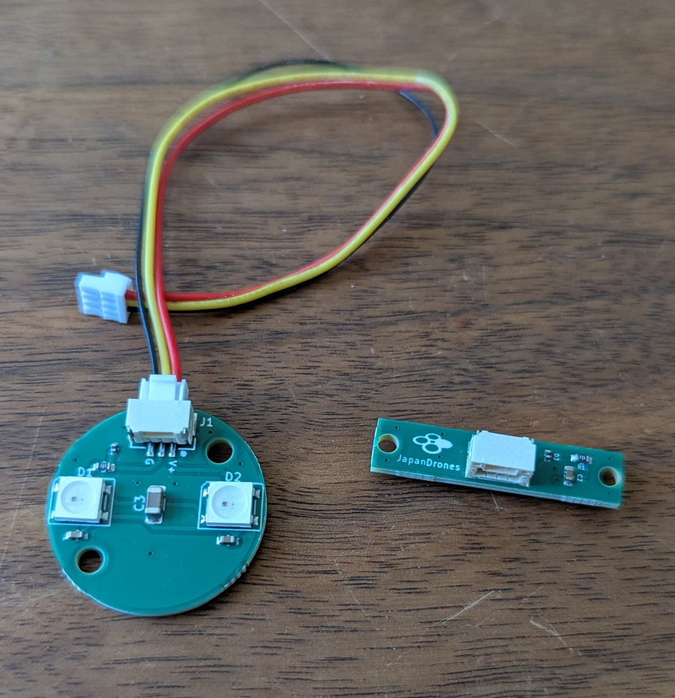

# JapanDrones LEDs

Two small RGB LED boards used on the JapanDrones aerial photography copter.

| Board | Folder | Size | Use |
|---|---|---|---|
| Round (V3) | [round/](round/) | 25 mm diameter | Mounted under each motor at the end of the arms |
| Rectangular (V4) | [rect/](rect/) | 29 x 6.6 mm | Mounted at the back of the vehicle so the pilot can easily see the vehicle's status |

Both boards share the same circuit:

- 2x SK6812 addressable RGB LEDs (NeoPixel compatible)
- JST-GH 3 pin connector (SM03B-GHS-TB): VCC (5V), GND, data
- 330R series resistor and TVS diode protecting the data input, plus decoupling capacitors

They work with ArduPilot's NeoPixel / SK6812 LED support (e.g. `SERVOx_FUNCTION` = NeoPixel and `NTF_LED_TYPES`).

## Files in each board folder

| File | What it is |
|---|---|
| `*.kicad_pro`, `*.kicad_sch`, `*.kicad_pcb` | KiCad 9 project, schematic and PCB. All symbols and footprints are embedded so no extra libraries are needed |
| `fab/*-fab.zip` | Gerber and drill files (plus the original PCBWay BOM, positions and netlist). This is the exact zip PCBWay built from |
| `fab/bom.csv` | Bill of materials (parts list) with manufacturer part numbers (the parts PCBWay actually fitted), alternates and LCSC numbers |
| `fab/positions.csv` | Pick and place (a.k.a. centroid or CPL) file: the X/Y position, rotation and side of each part, used by the assembly machine |
| `3d/*.step` | 3D model of the assembled board for mechanical CAD (Fusion 360, FreeCAD, SolidWorks, ...) |
| `3d/*.stl` | Mesh of the assembled board. Click it on GitHub to view it in 3D |

## Ordering

### PCBWay (PCB + assembly)

1. Go to PCBWay's PCB instant quote and upload `fab/<board>-fab.zip`
2. Board options: 2 layers, 1.6 mm thickness (other options as you prefer)
3. Select "Assembly service". The round board has parts on the top side only, the rectangular board has parts on both sides
4. Upload `fab/bom.csv` and `fab/positions.csv` when asked for the BOM and centroid files

Note: the SK6812 LEDs are moisture sensitive and should be baked before reflow (PCBWay does this automatically).

### Other manufacturers

The zip contains standard Gerber (RS-274X) and Excellon drill files, which any PCB manufacturer accepts.
For assembly, most services (JLCPCB, Seeed, Elecrow, ...) accept a BOM and pick and place CSV, though column names may need to be adjusted to match their template.
You can also re-generate the files in your manufacturer's preferred format by opening the `.kicad_pcb` in KiCad 9.

## Licence

[CERN-OHL-S-2.0](../LICENSE.txt)
